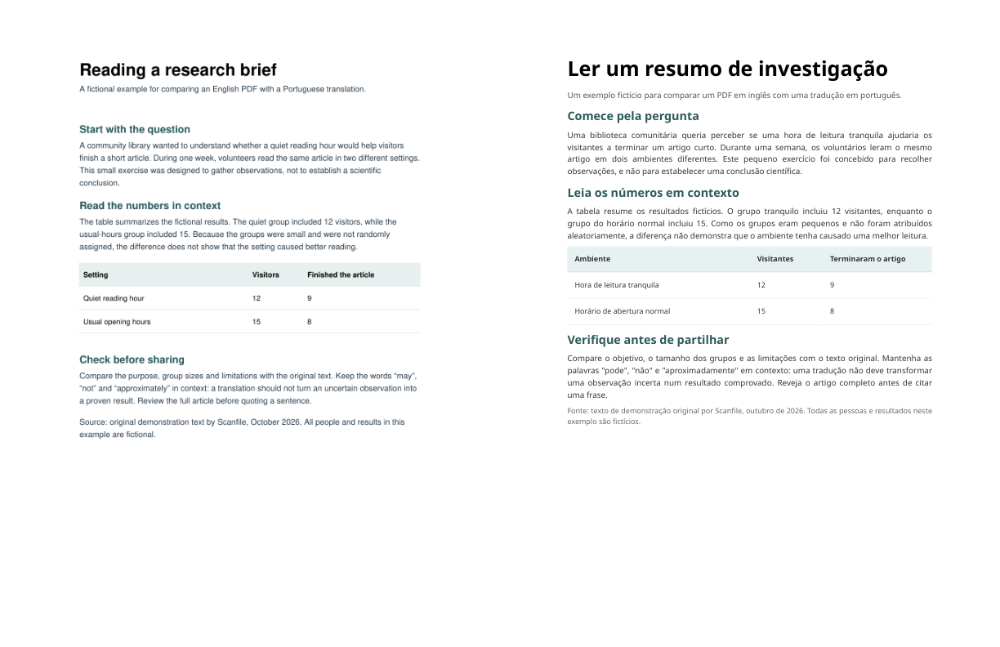

# PDF translation review: original beside translation

Research workflow: [review a translated PDF alongside its Zotero attachment](examples/zotero-research-paper.md). This is a manual workflow, not a Zotero plugin.

Practice: [German-to-English PDF review exercise](examples/german-english-review.md), with a fictional source and a hand-written reference rendering.

[Leia em português do Brasil](README.pt-BR.md)

Create a two-column PDF for **manual review** from an original PDF and a translated PDF. The original appears on the left, the translation on the right. Everything runs on your computer: the program does not upload files or call a translation service. It works with translations from any source.



The example above uses a fictional English reading brief and one actual Scanfile Portuguese translation. Fonts and line breaks differ; it is not a quality benchmark or evidence about other files.

**This tool does not translate, match pages automatically, compare meanings, detect missing text, or certify a translation.** Choose corresponding pages yourself. Open the result and check every pair, including names, negative statements, numbers, units, tables, footnotes, figures, and any overflow.

## Setup

Install Python 3.10 or later. Download the wheel from the [CLI v0.1.0 release](https://github.com/taosz/pdf-translation-review/releases/tag/v0.1.0), then install it from your terminal:

```sh
python -m pip install scanfile_pdf_translation_review-0.1.0-py3-none-any.whl
```

Run that command from the directory containing the downloaded wheel, or supply its full path. Installing the dependency requires an internet connection. The review command itself works offline. The only runtime dependency is [pypdf](https://pypdf.readthedocs.io/). To run from a source checkout instead, install `requirements.txt` and replace `pdf-translation-review` in the examples with `python pdf_review.py`.

## Make a review copy

```sh
pdf-translation-review original.pdf translated.pdf -o review.pdf
```

Both files need the same number of pages for the default command. For a translation covering original pages 8–10, where the translation starts at its own page 1:

```sh
pdf-translation-review original.pdf translated.pdf -o review.pdf --source-start 8 --translation-start 1 --pages 3
```

Page numbers refer to positions in each PDF, not necessarily printed page labels. The output path must be new; the tool does not overwrite an existing file. Review copies may contain the full contents of both documents. Handle the output with the same care as the inputs, and only process files you are allowed to use.

## Use in GitHub Actions

You can create a review copy in a Linux workflow after checking out a repository containing both PDFs. The action requires Python 3.10 or newer, installs a pinned version of pypdf, and runs the same review code on the runner. It needs no Scanfile account, API key, or additional GitHub permissions. The comparison is manual; the action does not translate or verify the files.

```yaml
name: Create translation review
on: [workflow_dispatch]
permissions:
  contents: read
jobs:
  review:
    runs-on: ubuntu-latest
    steps:
      - uses: actions/checkout@v4
      - uses: actions/setup-python@v5
        with:
          python-version: '3.12'
      - uses: taosz/pdf-translation-review@27b431ef1227bd913d41c803b0b1fda833f31ebd
        with:
          original: docs/original.pdf
          translation: docs/translated.pdf
          output: review.pdf
          # Optional: source-start, translation-start, pages
      - uses: actions/upload-artifact@v4
        with:
          name: translation-review
          path: review.pdf
          retention-days: 1
```

Replace the example paths with authorized files. The action itself creates a file on the runner and does not upload it; the final, optional step explicitly uploads the review copy to GitHub so it can be downloaded from the run. The copy contains both documents. Check your repository's artifact access and retention settings before adding that step, and do not upload confidential documents unless your organization permits it. On a hosted runner, omitting that step leaves no downloadable artifact after the job ends. The PDF dependency installation contacts its package index. A successful run only means a copy was created: inspect the output and verify translation manually. Avoid privileged workflows that process untrusted pull-request content.

## Limits

- Each input must be an unencrypted PDF, at most 50 MiB and 200 pages. Password-protected PDFs are not supported.
- Pages are scaled to fit a two-column sheet. Small text may be difficult to read, and unusual page sizes, page boxes, rotated pages, fonts, layers, and complex graphics may render differently. Always check the result in a PDF reader against both inputs.
- This produces a visual reading copy, not an archival or accessible edition. Links, annotations, forms, bookmarks, tags, signatures, metadata and interactive behavior may be removed or altered. Text selection is not guaranteed. It does not remove hidden information or sanitize malicious PDFs.
- The output is not encrypted. Neither input is changed. The output does not include any automatic review or guarantee about translation quality.

## Example and web option

Try the [technical datasheet review exercise](examples/technical-datasheet.md) to inspect an actual English-to-Spanish output, including known errors. [Ejercicio en español](examples/technical-datasheet.es.md).

For a no-install first look, try the [fictional bilingual example in the Hugging Face reader](https://huggingface.co/spaces/zsoat/pdf-translation-review). That practice text is invented and is not a Scanfile translation or a quality benchmark; the separate reader also lets you open your own files locally.

Scanfile's developer maintains this project. For an actual one-page example, download the [image-only English original](https://scanfile.online/samples/pdf/scanned-en-pt/reading-brief.en.pdf) and [Portuguese output](https://scanfile.online/samples/pdf/scanned-en-pt/reading-brief.pt.pdf), then compare them. The output is one real example, not evidence of quality on other files; inspect the actual wording and layout yourself.

For a browser view without installing Python, the [Scanfile PDF review reader](https://scanfile.online/tools/pdf-translator?sf_campaign=github_pdf_review#compare-pdf-translation) opens two selected PDFs locally and lets you select pages independently. The link includes a fixed campaign label for privacy-conscious aggregate analytics; no filename or document content is included. Its web analytics follow your browser privacy settings. Scanfile's separate translation service requires a file upload and follows its displayed trial and credit rules; this command-line tool does neither.

Use an original and translation you are authorized to process. Translation for official or high-stakes use may require qualified human review or certification.
