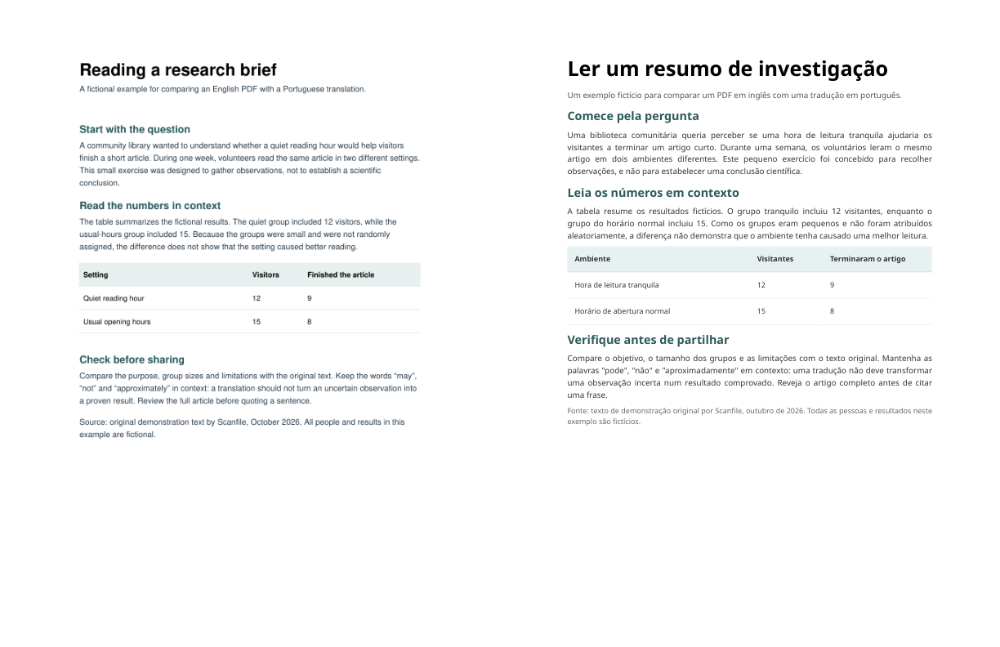

# Revisão de tradução em PDF: original ao lado da tradução

Crie um PDF em duas colunas para **revisão manual**, a partir de um PDF original e de outro traduzido. O original fica à esquerda e a tradução à direita. O programa funciona no seu computador: ele não envia arquivos nem chama um serviço de tradução. Você pode usá-lo com traduções de qualquer origem.



O exemplo mostra um documento fictício em inglês e uma tradução real para português feita pelo Scanfile. As fontes e as quebras de linha são diferentes. Este único exemplo não mede a qualidade da tradução nem comprova o resultado para outros arquivos.

**Esta ferramenta não traduz, não alinha páginas automaticamente, não compara significados, não detecta trechos ausentes e não certifica traduções.** Escolha as páginas correspondentes e confira cada par: nomes, negações, números, unidades, tabelas, notas, figuras e texto que ultrapasse os limites da página.

## Instalação

Instale Python 3.10 ou mais recente. Baixe o arquivo wheel na [versão 0.1.0 da linha de comando](https://github.com/taosz/pdf-translation-review/releases/tag/v0.1.0) e execute no terminal:

```sh
python -m pip install scanfile_pdf_translation_review-0.1.0-py3-none-any.whl
```

Execute o comando na pasta que contém o wheel ou informe o caminho completo. A instalação da dependência requer internet; o comando de revisão funciona sem conexão. A única dependência de execução é [pypdf](https://pypdf.readthedocs.io/). Para usar o código-fonte em vez do wheel, instale `requirements.txt` e substitua `pdf-translation-review` por `python pdf_review.py` nos exemplos.

## Criar uma cópia para revisão

```sh
pdf-translation-review original.pdf traduzido.pdf -o revisao.pdf
```

No comando padrão, os dois arquivos devem ter a mesma quantidade de páginas. Se a tradução corresponder às páginas 8 a 10 do original e começar na página 1 do arquivo traduzido:

```sh
pdf-translation-review original.pdf traduzido.pdf -o revisao.pdf --source-start 8 --translation-start 1 --pages 3
```

Os números indicam posições nos arquivos PDF, que podem ser diferentes da numeração impressa. O caminho de saída deve ser novo: a ferramenta não sobrescreve arquivos. A cópia pode conter todo o conteúdo dos dois documentos; proteja-a como protege os originais e use apenas arquivos que você tem autorização para processar.

## Usar no GitHub Actions

O projeto também oferece uma [Action para gerar a cópia de revisão](https://github.com/taosz/pdf-translation-review#use-in-github-actions) em um runner Linux com Python. O exemplo e os nomes dos parâmetros estão em inglês. A Action instala a dependência, usa dois PDFs presentes no workspace e não envia arquivos ao Scanfile nem traduz ou verifica o conteúdo. A revisão continua sendo manual.

O exemplo inclui uma etapa **opcional** para enviar o PDF resultante como artefato ao GitHub. Essa cópia contém os dois documentos: verifique as regras de acesso e retenção do repositório antes de usá-la. Sem essa etapa, o arquivo não fica disponível para download após o término de um runner hospedado. Use somente documentos que você tem autorização para processar.

## Limitações

- Cada entrada deve ser um PDF sem criptografia, com no máximo 50 MiB e 200 páginas. PDFs protegidos por senha não são aceitos.
- As páginas são dimensionadas para caber lado a lado. Letras pequenas podem ficar difíceis de ler; tamanhos e caixas de página incomuns, rotações, fontes, camadas e gráficos complexos podem ser renderizados de forma diferente. Confira o resultado em um leitor de PDF comparando-o com as duas entradas.
- A saída é uma cópia visual de leitura, não uma edição de arquivamento ou acessível. Links, anotações, formulários, marcadores, tags, assinaturas, metadados e elementos interativos podem ser removidos ou alterados. A seleção de texto não é garantida. A ferramenta não remove informações ocultas nem saneia PDFs maliciosos.
- O arquivo de saída não é criptografado. As entradas não são alteradas. Não há revisão automática nem garantia de qualidade da tradução.

## Exemplo e opção no navegador

O desenvolvedor do Scanfile mantém este projeto. Para experimentar com um exemplo real de uma página, baixe o [original em inglês composto por imagem](https://scanfile.online/samples/pdf/scanned-en-pt/reading-brief.en.pdf) e o [resultado em português](https://scanfile.online/samples/pdf/scanned-en-pt/reading-brief.pt.pdf). É apenas um exemplo; examine o texto e a apresentação por conta própria.

Se preferir não instalar Python, o [leitor de comparação do Scanfile](https://scanfile.online/pt-br/tools/pdf-translator?sf_campaign=github_pdf_review#compare-pdf-translation) abre dois PDFs selecionados localmente no navegador e permite escolher as páginas de cada um. O link contém um identificador fixo de campanha para análise agregada; ele não inclui nome ou conteúdo de arquivo. A análise do site segue as configurações de privacidade do navegador. O serviço de tradução do Scanfile é separado: exige envio de arquivo e segue as regras de teste e créditos exibidas no site. A ferramenta de linha de comando não faz nenhum dos dois.

Use um original e uma tradução que você tenha autorização para processar. Traduções para uso oficial ou de alto impacto podem exigir revisão humana qualificada ou certificação.

